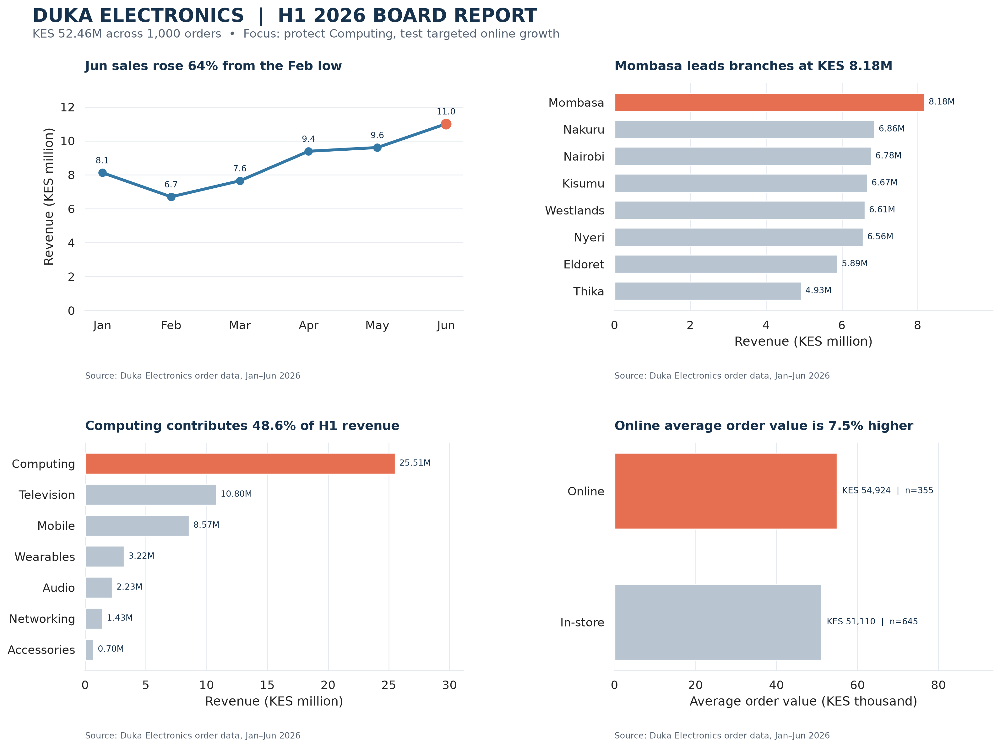

# Duka Electronics | H1 2026 board report

## Board Summary

First-half sales reached KES 52.46 million across 1,000 orders, averaging KES 52,464 per order. Momentum improved after February’s KES 6.70 million low: June reached KES 11.00 million, up 64% from February. The recovery was not evenly distributed. Computing generated KES 25.51 million, or 48.6% of revenue, making stock availability in this category a priority. Mombasa led branches with KES 8.18 million, while Thika recorded KES 4.93 million; branch results therefore warrant targeted follow-up rather than a national assumption. Online orders averaged KES 54,924, 7.5% above in-store orders, although stores contributed more total revenue. This difference is descriptive, not proof that online marketing caused higher baskets. We recommend protecting Computing availability and approving a measured 90-day online campaign pilot. Track revenue, average order value, and category mix by branch against a baseline before expanding. Review pilot results at the next board meeting, and adjust stock and marketing allocation using comparable performance.

## Reproducibility

- Source: `duka_sales.csv`, 1,000 synthetic orders dated January 1–June 30, 2026.
- Revenue is `units_sold × unit_price`; all monetary values are Kenyan shillings (KES).
- Install with `python -m pip install -r requirements.txt`, then open `board_report.ipynb` and run all cells from a fresh kernel.
- The notebook writes the report and before/after figures to `reports/` and `figures/`.
- The report is descriptive; observed channel and branch differences do not establish causation.

## Dashboard

The Looker Studio dashboard link and screenshots are tracked in [dashboard.md](dashboard.md). A signed-in Google account is required to create and publish the dashboard.
